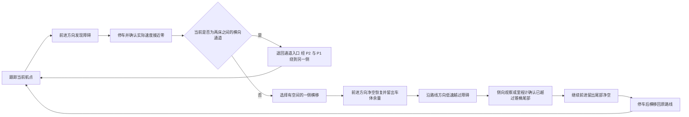

# 无激光雷达的四路测距航点绕行

`mission_complete.launch` 的航点模式默认开启 `enable_range_avoidance:=true`。
行驶中仅用新鲜有效的近障碍读数触发避障，NaN、超量程、无回波、超时或某路缺失不会单独导致停车。
车辆使用现有前、左、右、后四路 VL53 和 `/odom`，在 `path_tracker_node` 内生成
临时绕行速度；中间横向通道遇障可改走经 P1 的备用路线。不需要 `/scan`、地图或 move_base。
底盘必须能稳定横移，四个传感器必须分别朝车体前、左、右、后。

## 动作流程



左右两侧至少一侧达到选边距离才会横移。两侧都可走时选择空间较大的一侧，
接近相等时默认选左；选定后保持同一侧，避免在障碍前左右反复切换。
每次前进/横移阶段转换都会先停车，并用里程计反馈确认速度接近零。

### cross passage 经 P1 改道

默认 `paths.yaml` 为 P3L↔P3R 配置了双向备用路线。行驶中检测到有效近障碍，
先制动并确认停稳，然后在首次横移前切换路线，不在中间通道尝试横移穿越：

- 1 床到 3 床：当前位置 → P3L → P2L → **P1** → P2R → P3R → P6。
- 3 床到 1 床：当前位置 → P3R → P2R → **P1** → P2L → P3L → P4。

先沿刚驶过的通道退回入口，不从通道中途斜切向 P1。默认前进模式会先转向，
再正向驶回入口；所有转向及行驶继续受四路测距和独立防撞保护。经过 P1 仅为
绕路，不重入扫码状态，不重复开药箱；到达原目标床终点后才发布路径完成。
备用路线不再自动切回中间通道，后续障碍使用原局部绕行/停车机制。

路径配置中的 `blocked_point_index: 2` 为从零计数的目标点索引，仅保护该目标点
对应的横向路段；`fallback_path` 指向备用路径。加载时校验备用路径存在、无递归、
从被挡路段入口开始且到达相同终点。其他路段、动态参数覆盖不触发这项切换。
测距失效不会触发堵路或停车；有效近障碍一旦被检测到，记录位置后完成绕行，不因随后丢失回波直接恢复原路线。

切换状态为 `REROUTING`，可用 `rostopic echo /path_manager/active_path` 查看
当前路径（`bed1_to_bed3_via_p1` / `bed3_to_bed1_via_p1`）。此逻辑用于
`path_tracker_node` 航点模式；`use_dynamic_navigation:=true` 的 move_base 模式仍
使用 `/scan` 代价地图，四路 Range 尚未接入其全局规划器。

P1 通道的障碍物轮廓和真实净空仍需现场核对。改道增加里程和转向，导航阶段
预算由 75 秒调整为 120 秒，180 秒总任务超时继续生效；超过时限会停车。
经过 P1 时使用同坐标的 `P1_PASS`，容差 50 mm，不要求对齐扫码朝向。

锥桶离开视场后可能没有任何有效回波。绕行保留首次检测距离，加上传感器到车体中心的偏置与锥桶纵向尺寸，
用里程计估算障碍尾部；既可以通过侧向有效测距观察到障碍边缘，也可以在里程计确认越过记忆中的障碍后，
再多前进 `pass_margin_m`，才停车横移回线。持续检查所有新出现的有效近障碍。
锥桶底座直径已确认为 0.50 m，纵向记忆尺寸设为 `obstacle_length_m: 0.50`；净空加车体半径 `0.25 m` 后换算为相对车心的位置。
无回波不会伪造为远距离读数，也不能消除已记录的锥桶；超时、偏移限制、里程计失效、急停和任务取消仍会停车。

支持沿车体前、左、右、后方向的路径平移，左右绕行方向按当前行驶方向换算。
默认任务仍采用“先转向航点、再正向行驶”；仅在绕行阶段使用横移。
目标方向需接近一个传感器轴向；原地转向和明显斜向运动仍由原防撞逻辑保护。

绕行中不判定航点完成，也不会跳过一个被障碍占据的航点。回线并停稳后，
继续接近原航点，达到其位置/朝向容差后才请求下一点。

## 参数与状态

参数文件：`path_manager/config/range_avoidance.yaml`；命名空间是跟踪器私有
`range_avoidance/`。默认值用于低速调试，车体尺寸、传感器安装偏置和实测制动性能
需要体现在净空和横移/越障余量中，不能只按 VL53 读数决定车轮是否已经越过边缘。

| 参数 | 默认值 | 作用 |
| --- | --- | --- |
| trigger_m | 0.70 m | 行驶方向出现近障碍时开始停车选边 |
| front_clear_m | 0.90 m | 横移后的行驶方向净空要求 |
| side_space_m | 0.80 m | 初次选边所需的测距 |
| motion_clearance_m | 0.40 m | 绕行方向的最低净空 |
| min_offset_m | 0.70 m | 初次横移的最小偏移 |
| edge_margin_m | 0.35 m | 前方净空恢复后继续横移的距离 |
| pass_margin_m | 0.45 m | 返回通道恢复后继续越过障碍的距离 |
| speed_mps | 0.12 m/s | 绕行速度上限，配置不得超过 0.15 m/s |
| max_offset_m | 1.25 m | 相对原路线的最大横向偏移 |
| max_forward_m | 3.0 m | 单次绕行最多向路线方向推进的距离 |
| timeout_sec | 45 s | 单次绕行最长时间 |
| stall_sec | 6 s | 位移无明显进展的最长时间 |
| range_timeout_sec | 0.20 s | 任一路测距的最大年龄 |

`motion_clearance_m` 必须大于当前绕行速度对应的防撞制动阈值加释放滞回。
当前默认参数下，0.12 m/s 的直线制动阈值为车体外缘净空 150 mm，释放需超过
180 mm，绕行最低净空另取更保守的 400 mm。绕行模块始终不能覆盖防撞停车或 STM32 本地停车。

查看状态：

```bash
rostopic echo /path_tracker/avoidance_state
```

- `TRACKING`：正常跟踪航点。
- `REROUTING`：已停稳并选择经 P1 的备用路线，等待新路径版本。
- `BRAKING`、`SIDESTEP`、`BYPASS`、`EDGE_CLEAR`、`RETURN`：绕行各阶段。
- `WAIT_ODOMETRY`：里程计缺失、无效或过期，输出零速度。测距失效不进入等待停车状态。
- `NO_SIDE_SPACE`、`SIDE_BLOCKED`、`FRONT_BLOCKED`、`RETURN_BLOCKED`：相关方向没有足够空间，停车等待。
- `FAILED_*`：超时、无进展、偏移越界、朝向漂移或目标被挡住，持续停车。

测距失效期间继续已记录障碍的绕行；单次绕行的时间/进展上限不会因此重置。
失败后需要新的路径版本或新目标才能重新导航。取消或急停后，即使复位也不会
恢复旧路径，仍需新的路径版本。检测到阻塞时，任务原有阶段超时/取消机制继续生效。

## 启动与调试

```bash
cd /home/fire/ros_ws
catkin_make
source devel/setup.bash
roslaunch robot_navigation mission_complete.launch
```

只测试航点和底盘，不启动完整送药任务：

```bash
roslaunch robot_navigation complete_navigation.launch \
  enable_vl53l1x_can:=true \
  enable_range_avoidance:=true \
  path_tracker_params:=$(rospack find robot_bringup)/config/path_tracker_forward_only.yaml
```

然后用现有 `/select_path` 服务选择路径。禁用绕行可传入
`enable_range_avoidance:=false`，原防撞停车仍然保留。四路配置话题和有效范围应与
CAN 桥一致，后方仍使用 sensor_id=5。

这个策略针对途中锥桶等独立障碍。四束测距不能识别物体类别或提供完整轮廓；无回波时按航点继续行驶，
检测到有效近障碍后再绕行。健康监控默认只把里程计和电机状态作为关键心跳，测距掉线不再触发全局急停。
自定义 `critical_topics` 中若仍包含四路测距，需同步移除，才符合这项行驶策略。

P4/P6 停靠使用前向 VL53 校准到 **250 mm ±10 mm**，校准必须有有效前向测距；
读不到时保持不动等待，25 秒内未恢复则校准失败，不会直接开箱放药。其他三路无需同时有效，回家判定也不要求四路回波。
普通制动规则允许 250 mm 低速校准，无需切换校准专用制动模式。
STM32 若仍执行文档中的 ≤300 mm 本地停车，必须同步调整固件规则；ROS 不覆盖固件急停。

## 圆形车体与净空换算

整车按半径 **0.25 m** 的圆形计算，前传感器位于外缘，其余三路向内缩 **0.05 m**。
全局安装参数见 `robot_navigation/config/chassis_geometry.yaml`，制动节点和绕行节点读取同一组偏置。
Range 话题仍保留传感器原始距离；两个节点内部分别换算：前向净空等于原始距离，侧后净空等于 `max(0, 原始距离 − 0.05 m)`。
补偿后为零仍是有效近障碍，不能当作缺测忽略。下表及绕行参数中的距离均为车体外缘净空。

平移停车阈值（mm）为 `max(150, 1000 × (v²/(2a) + v×t) + 100)`，另保留 100 mm 临界值；
`v` 取请求速度和实测速度中朝该传感器方向的较大分量，默认减速度 `a=1 m/s²`、反应时间 `t=0.2 s`。
例如 0.25 m/s 时，前向停车读数约 181 mm，侧后约 231 mm；0.20 m/s 时分别为 160 mm 和 210 mm。
释放滞回为 30 mm，小于停车阈值 1.5 倍时限速至 30%。减速度与反应时间需通过实车制动测量确认。

圆形车体原地旋转的外廓不变，不把切向速度重复计入接近速度；转动期间仍检查四路有效测距，车体外缘净空 ≤100 mm 停车。
转向同时平移时，朝障碍方向的平移分量仍执行动态制动。此模型要求整车凸出部件均包含在 25 cm 半径内。
锥桶横移最小偏移保持 0.70 m，车体半径 0.25 m、实际锥桶底座半径 0.25 m，正对锥桶时对应约 0.20 m 外缘净空，保留至少 0.10 m 的余量要求；
检测到边缘后额外横移 0.35 m、越过尾部后额外前进 0.45 m，避免只因锥桶离开测距视场就提前切回。

## 自动化验证

```bash
catkin_make run_tests_path_manager_gtest_test_range_detour
rostest path_manager range_detour.test
rostest path_manager cross_passage.test
rostest path_manager path_tracker_transitions.test
rostest path_manager path_tracker_holonomic.test
rostest robot_navigation mission_closed_loop.test
rostest robot_navigation mission_closed_loop.test cross_passage_blocked:=true
```

策略测试覆盖完整绕行阶段、不同运动轴的选边换算、无空间、输入过期、边界与
朝向限制。闭环测试运行真实跟踪器、仲裁器和防撞节点，根据矩形障碍与围墙进行
五条视场射线测距，检查左右绕行、旋转后的坐标系、回到原航点、车体碰撞、输入
断线及取消/急停。这些模拟测试不打开真实 CAN，也不能代替实车净空和方向验收。

`cross_passage.test` 使用真实路径管理、前进跟踪、速度仲裁和防撞节点，注入
通道行驶中途的障碍和后方 NaN，检查其他三路无回波时双向改道、实际经过 P1、入口回退、
原目标床到达前不完成、无递归改道、取消停车，以及通道畅通时保留直达路线。

`mission_closed_loop.test cross_passage_blocked:=true` 验证改道后两床的药箱和
放药顺序；允许完整完成，或在已完成两床送药后因 180 秒总超时取消返程并停车。
后一种结果只表示超时保护有效，不能算比赛全程完成。

2026-10-15 首次改道验证结果（当时仍使用缺失测距停车策略）：独立临时目录编译通过；8 项绕行策略测试，以及改道、
原局部绕行、航点切换、全向跟踪、正常完整任务、堵路任务共 6 套 ROS 仿真通过。
正常两种送药顺序均在总时限内完成。堵路两种顺序均改走 P1 并完成两床投药，
但在返程时触发 180 秒总超时并停车，尚不能保证改道场景全程按比赛时限完成。
这些结果未连接实车 CAN，实车启用前仍需重新编译正式工作空间并实测通道净空及耗时。

2026-10-14 验证结果：独立临时工作区的 catkin 配置与编译通过，8 项策略测试、
绕行几何闭环、航点切换、全向跟踪及两种送药顺序的完整任务闭环全部通过。
两套导航入口也通过实际 ROS launch 解析，默认均开启测距绕行与先转向后前进。

2026-10-15 车体尺寸更新验证：半径 250 mm、侧后内缩 50 mm、车体外缘余量 100 mm 的配置已编译通过；
10 项绕行策略测试，以及防撞/250 mm 校准、后向 CAN 制动、绕行几何闭环、P1 双向改道、
行驶缺测的完整双顺序任务共 5 套 ROS 仿真通过。几何测试使用圆形车体与直径 600 mm 的锥桶，
检查至少 100 mm 外缘净空；完整任务在行驶阶段注入缺测，仅校准阶段提供前向距离，检查 P4/P6 实际完成校准。
三个导航 launch 参数解析通过。以上未连接实车 CAN；制动性能、锥桶外形及 STM32 本地停车规则仍需现场对齐。

后续根据用户确认，锥桶底座直径更新为 500 mm，纵向记忆尺寸同步改为 0.50 m，最小横移仍保留 0.70 m。
重新编译、10 项策略测试及使用 500 mm 锥桶模型的绕行闭环仿真通过，继续检查车体外缘至少 100 mm 净空。
